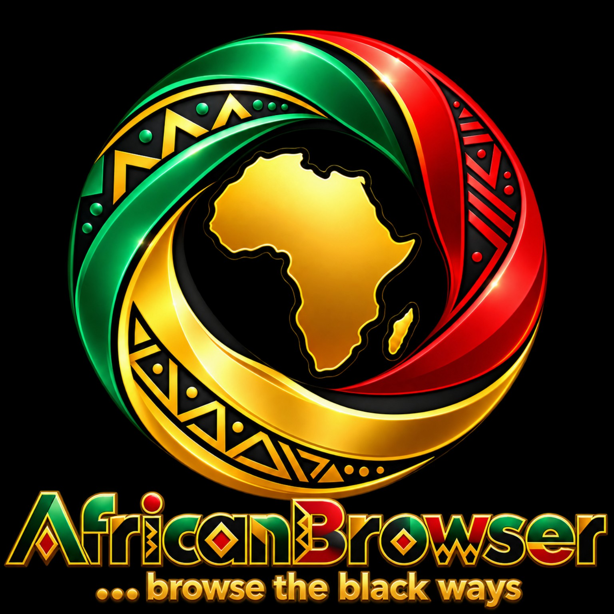

# AfricanBrowser

Owner: **Olamide Olatayo Bello**. Copyright © 2026 for original AfricanBrowser
work. Original code: BSD-3-Clause; upstream components retain their own licenses.

[Copyright and branding](COPYRIGHT.md) · [Code license](LICENSE) ·
[Third-party notices](NOTICE.md) · [Terms](TERMS.md) · [Privacy policy](PRIVACY.md)



An open source Chromium browser distribution project for Android, Windows,
macOS, Linux, and iOS/iPadOS. It builds the upstream browser, not a WebView or
Electron wrapper. Local code is BSD-3-Clause; upstream Chromium and its bundled
dependencies retain their own licenses and attribution.

**Current status: an Android ARM64 development APK is available; the project is not production-ready.**
[Download and review the development release](https://github.com/olamidebello/AfricanBrowser/releases/tag/android-development-38688333478).
It uses development signing and has not completed device acceptance testing.
No desktop installer, signed Apple application, production-verified browser release,
automatic update service, or Chrome feature-parity certification is provided yet.
See [public website build and deployment](docs/WEBSITE.md).

## Foundation

`config/upstream.json` pins Chromium 155.0.8059.39 and an immutable depot_tools
revision. The Chromium revision was obtained from ChromiumDash's Linux Stable
release feed on October 13, 2026. It is a starting baseline, not a guarantee that
all platforms use that version in their own stable channel. Review upstream
security updates before each release.

The browser source is downloaded into a separate checkout when building. The
repository contains the distribution overlay and reproducible build commands;
it does not vendor Chromium's enormous source tree. Branding updates product
names and English product strings, retaining upstream identifiers and legal
attribution. Android uses `org.africanbrowser.browser`; iOS uses the
`org.africanbrowser` bundle prefix; Linux's default profile is
`~/.config/africanbrowser`; macOS uses `org.africanbrowser.AfricanBrowser`.
The supplied Pan-African logo is preserved in `assets/branding/`. Builds apply
the complete supplied artwork to product PNGs, Windows ICO, macOS ICNS and Apple icon catalogs,
and Android launcher resources. The original lockup retains the name and slogan
“… browse the black ways.” Modern Apple asset compilation and platform icon
caches still need native build validation. Localized branding, Windows installer/profile
identity isolation, and platform branding review remain release work.

## Default home page

New builds use **https://africanbrowser.com/** as the default home page on
Android and desktop. Users can change their homepage in Settings; existing
custom preferences and managed policies take precedence. Android private
browsing keeps the native new tab page. Installing a rebuilt APK is required
to receive the Android application name and homepage changes.

## Browser features

Using the full upstream browser preserves its implementation of tabs, navigation,
bookmarks, history, downloads, private browsing, site permissions, accessibility,
password and autofill UI, printing/PDF, developer tools, and web platform APIs
where supported on the selected platform. Desktop extension support follows
upstream Chromium. Android and iOS do not have desktop Chrome's full extension
and DevTools experience. These inherited capabilities still require runtime
verification on each AfricanBrowser build.

Chrome's Google account sync, Google service access, proprietary DRM/codecs,
Google branding, proprietary AI features, and Google's update infrastructure
are not included merely by building Chromium. Never claim that this project
implements every exact Chrome feature. See [feature scope](docs/FEATURES.md).

## Build

Use a dedicated native build machine with at least 200 GiB of free SSD storage,
32 GiB RAM recommended, Git, Python 3.11+, and the native SDKs required by the
pinned upstream documentation. The preflight enforces 100 GiB free as a lower
bound, not a promise that the complete build will fit. Android builds on Linux;
Apple builds on macOS; Windows builds on Windows. Install Linux dependencies
after checkout using the pinned upstream instructions; the script does not
silently install packages as root.

```sh
python3 -m pip install -r requirements-build.txt
python3 scripts/browser.py plan --target android --cpu arm64
python3 scripts/browser.py doctor --target android
python3 scripts/browser.py checkout --target android --cpu arm64 --work /large-disk/africanbrowser
# Follow work/android/src/docs/android_build_instructions.md to install build dependencies.
python3 scripts/browser.py build --target android --cpu arm64 --work /large-disk/africanbrowser
python3 scripts/browser.py package --target android --cpu arm64 --work /large-disk/africanbrowser
```

For desktop use `--target linux`, `windows`, or `macos` and `--cpu x64` or
`arm64` as supported by the host toolchain. On Windows use `python` in a native
command prompt, install the required Visual Studio/SDK, and set
`DEPOT_TOOLS_WIN_TOOLCHAIN=0`. Use short paths without spaces. Do not share
depot_tools or a source checkout between native Windows and WSL.

For iOS use `--target ios --cpu arm64` on an Apple Silicon Mac. This initial
configuration builds for the **simulator**, not an installable signed IPA.
iPhone/iPad device distribution requires Apple signing identities, entitlements,
and provisioning profiles. Consult the pinned source's
`docs/ios/build_instructions.md` for device settings and supported engine options.

Compiled development artifacts go to `dist/` with build metadata and SHA-256
checksums. Packaging fails if required build outputs are absent. Output remains
development software until [release acceptance](docs/RELEASE.md) is completed.

## Rebuild and deploy APK

Run `ansible-playbook -i ansible/hosting.example.ini ansible/rebuild-deploy.yml`
to pull the latest source, rebuild through GitHub Actions, verify the APK and
publish it on your hosting server. See [setup and recovery](docs/APK_DEPLOYMENT.md).

## Continuous integration

The hosted Android workflow attempts an ARM64 Chromium APK build after checking
runner storage. It uploads a development APK only on successful compilation.
Compilation now uses resumable segments to avoid losing completed objects at
the hosted job time limit. See [resumable build details](docs/RESUMABLE_BUILD.md).
See [local AI and Ansible automation](docs/AI_AND_AUTOMATION.md) for the local
support assistant, desktop side panel and Linux provisioning commands.

Hosted CI checks the Python tooling. The manually dispatched native build
workflow needs separately provisioned self-hosted workers labeled
`africanbrowser` and the platform name. Those workers must already have all SDKs
and OS dependencies installed. The workflow does not publish releases or claim
signing, runtime tests, or automatic updates. A dirty upstream checkout is not
reset automatically: use a fresh work directory for a new checkout/release.

```sh
python3 -m unittest discover -s tests -v
```

## Upstream documentation

- https://chromium.googlesource.com/chromium/src/+/155.0.8059.39/docs/linux/build_instructions.md
- https://chromium.googlesource.com/chromium/src/+/155.0.8059.39/docs/android_build_instructions.md
- https://chromium.googlesource.com/chromium/src/+/155.0.8059.39/docs/windows_build_instructions.md
- https://chromium.googlesource.com/chromium/src/+/155.0.8059.39/docs/mac_build_instructions.md
- https://chromium.googlesource.com/chromium/src/+/155.0.8059.39/docs/ios/build_instructions.md
- https://www.chromium.org/developers/how-tos/api-keys/
